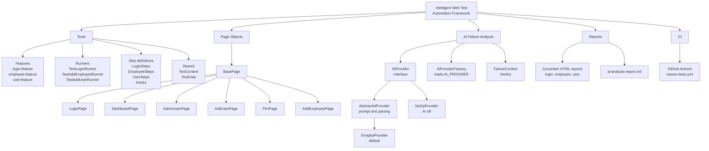

[](https://github.com/ramibentaieb-qa/IntelligentWebTestAutomationFramework/actions/workflows/maven-tests.yml) 
# Intelligent Web Test Automation Framework

A Selenium and Cucumber test framework that explains its own failures. When a test fails, it sends a screenshot, the page HTML and the assertion message to an AI model, and gets back a likely root cause and a suggested fix instead of just a stack trace.

I built it to practice UI test automation, and because reading failures is the part of testing I find most tedious.

## What's in it

- Java 25, Maven
- Selenium 4, headless Chrome via WebDriverManager
- Cucumber 7 on the JUnit 5 platform, Page Object pattern
- GitHub Actions CI, uploading the Cucumber HTML report

````
1. Tests run against the public OrangeHRM demo site: three features: login,add employee,and add user.
2. I generated unique test data on every test run, because the shared demo keeps what I create.
3. Reports file: `login.html`, `employee.html`, and `user.html` in place of one `cucumber.html`.
4. A “Known limits” bullet that the public demo can return 500s or reset, so an occasional red run can be the site and not the tests.
````

## Project structure

```
.github/workflows/maven-tests.yml   CI workflow (runs tests, uploads reports)
pom.xml                             Maven dependencies and build config

src/main/java/
├── ai/                             AI failure analysis
│   ├── AIProvider.java             Interface every backend implements
│   ├── AIProviderFactory.java      Picks the backend from AI_PROVIDER
│   ├── AbstractAIProvider.java     Shared prompt and verdict parsing
│   ├── GroqApiProvider.java        Groq backend (default)
│   ├── NoOpProvider.java           Used when AI analysis is turned off
│   ├── FailureContext.java         Screenshot, page source and error message
│   └── Verdict.java                Category, summary and suggested fix
└── pages/                          Page Object classes
    ├── BasePage.java               Shared waits and actions
    ├── LoginPage.java
    ├── DashboardPage.java
    ├── AdminUserPage.java
    ├── AddUserPage.java
    ├── PimPage.java
    └── AddEmployeePage.java

src/test/java/
├── base/
│   ├── TestContext.java            Driver and pages shared per scenario
│   └── TestData.java               Generates unique names, usernames and IDs
├── runners/                        One JUnit 5 suite per feature
│   ├── TestLoginRunner.java
│   ├── TestAddEmployeeRunner.java
│   └── TestAddUserRunner.java
└── stepdefinitions/                Cucumber steps and hooks
    ├── Hooks.java                  @Before / @After, runs the AI analysis
    ├── LoginSteps.java
    ├── EmployeeSteps.java
    └── UserSteps.java

src/test/resources/features/        Gherkin feature files
├── login.feature
├── employee.feature
└── user.feature
```

## Project map



## How the failure analysis works

1. On a failed scenario, the `@After` hook captures a screenshot, the page source and the assertion message.
2. `AIProviderFactory` reads `AI_PROVIDER` and picks a backend (`GroqApiProvider` by default).
3. The screenshot, truncated HTML and error message are sent to Groq with a prompt asking for a category, a summary and a suggested fix.
4. The result is printed to the console, attached to the Cucumber report, and appended to `target/ai-analysis-report.md`.

Categories: `LOCATOR_BROKEN`, `ASSERTION_MISMATCH`, `TIMING_FLAKE`, `ENVIRONMENT_ISSUE`, `UNKNOWN`.

Early on, the AI called a wrong-password rejection an `ENVIRONMENT_ISSUE` — the summary was right, the label wasn't, because the prompt never defined what separated the categories. Fixing that prompt (in `AbstractAIProvider`) was most of the real work here.

## Why Groq, not Gemini

Gemini's free tier rate-limits by requests per minute — running three login examples in parallel was enough to trigger `429`s even with retries. Groq's free tier (30 RPM, confirmed with a vision-capable model) held up better, so I rewrote `GeminiApiProvider` into `GroqApiProvider`, same retry logic, different endpoint.

I also tried a fully local backend with Ollama, for zero data leaving the machine. My hardware (old dual-core, no GPU) couldn't run it reliably, so I dropped it rather than ship something that didn't work.

## Configuration

| Variable | Required | Default |
|---|---|---|
| `AI_PROVIDER` | No | `groq` (`none` disables it) |
| `GROQ_API_KEY` | For AI analysis | - free at [console.groq.com/keys](https://console.groq.com/keys) |
| `GROQ_MODEL` | No | `qwen/qwen3.8-27b` |

No key set → tests still run, just without AI analysis. In CI, the key comes from a GitHub Actions secret (`GROQ_API_KEY`). Never commit it.

## Running it

Reports land in `target/cucumber-reports/` (HTML, with screenshots) and `target/ai-analysis-report.md`.

## Known limits

- The AI can be wrong — it's a hint, not a verdict.
- Error messages are only captured in the last step; an earlier failure gets "not captured."
- Screenshots and HTML go to Groq, fine for this public demo site, not for anything sensitive.